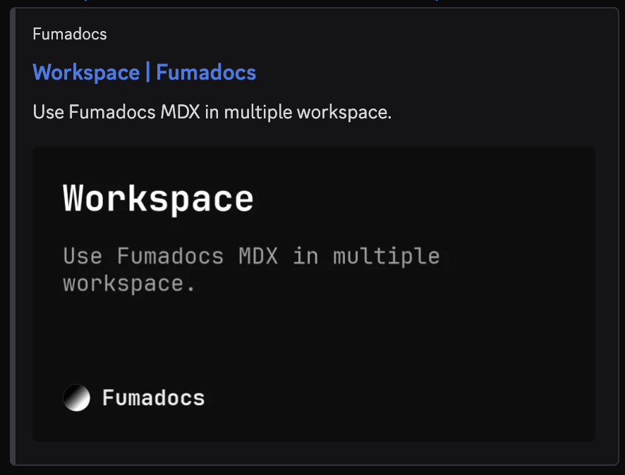

你可以设置 [Open Graph](https://ogp.me) 图片元数据，用来定义文档页面在网站或社区媒体上显示的预览图片，例如：

  

你可以使用 [Takumi](/docs/integrations/og/takumi)<show when={props.framework === 'next'}>，或 [`next/og`](/docs/integrations/og/next)</show> 来生成这些图片。

<DocsCategory />