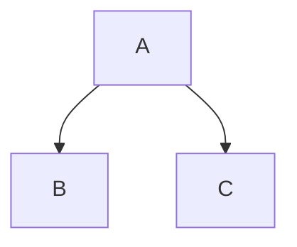

Fumadocs 并未内建 Mermaid 包装元件，建议您直接使用 `mermaid`。

您可以自行选择要设定的 Mermaid 算绘器：

### 官方算绘器 [#official-renderer]

```npm
npm install mermaid
```

建立 Mermaid 元件：

```tsx title="components/mdx/mermaid.tsx"
'use client';

import { use, useId, useSyncExternalStore } from 'react';

export function Mermaid({ chart }: { chart: string }) {
  // 在伺服器端及 hydration 期间为 `false`
  const isClient = useSyncExternalStore(
    () => () => {},
    () => true,
    () => false,
  );

  if (!isClient) return;
  return <MermaidContent chart={chart} />;
}

const cache = new Map<string, Promise<unknown>>();

function cachePromise<T>(key: string, setPromise: () => Promise<T>): Promise<T> {
  const cached = cache.get(key);
  if (cached) return cached as Promise<T>;

  const promise = setPromise();
  cache.set(key, promise);
  return promise;
}

function subscribeTheme(onChange: () => void) {
  const observer = new MutationObserver(onChange);
  observer.observe(document.documentElement, { attributeFilter: ['class'] });
  return () => observer.disconnect();
}

function MermaidContent({ chart }: { chart: string }) {
  const id = useId();
  const theme = useSyncExternalStore(subscribeTheme, () =>
    document.documentElement.classList.contains('dark') ? 'dark' : 'default',
  );
  const { default: mermaid } = use(cachePromise('mermaid', () => import('mermaid')));

  mermaid.initialize({
    startOnLoad: false,
    securityLevel: 'loose',
    fontFamily: 'inherit',
    themeCSS: 'margin: 1.5rem auto 0;',
    theme,
  });

  const { svg, bindFunctions } = use(
    cachePromise(`${chart}-${theme}`, () => {
      return mermaid.render(id, chart.replaceAll('\\n', '\n'));
    }),
  );

  return (
    <div
      ref={(container) => {
        if (container) bindFunctions?.(container);
      }}
      dangerouslySetInnerHTML={{ __html: svg }}
    />
  );
}
```
[Pele](https://pele.run) 是一款轻量的 Mermaid 算绘器，可输出能套用主题的 SVG。

```npm
npm install pele
```


```tsx title="components/mdx/mermaid.tsx"
import { useId } from 'react';
import { CodeBlock, Pre } from 'fumadocs-ui/components/codeblock';
import { render } from 'pele';

export function Mermaid({ chart }: { chart: string }) {
  const id = useId();

  try {
    // also lay out the chart for phones, the container query shows the one that fits
    const wide = render(chart, { idPrefix: id });
    const narrow = render(chart, { idPrefix: `${id}narrow`, maxWidth: 320 });

    if (narrow.width >= wide.width) return <div dangerouslySetInnerHTML={{ __html: wide.svg }} />;

    return (
      <div className="@container">
        <div className="@max-[600px]:hidden" dangerouslySetInnerHTML={{ __html: wide.svg }} />
        <div className="@min-[600px]:hidden" dangerouslySetInnerHTML={{ __html: narrow.svg }} />
      </div>
    );
  } catch {
    return (
      <CodeBlock title="Mermaid">
        <Pre>{chart}</Pre>
      </CodeBlock>
    );
  }
}
```


将它的字型与颜色对应至 Fumadocs，让图表随浅色／深色模式切换：


```txt title="global.css"
@import 'tailwindcss';
@import 'fumadocs-ui/css/neutral.css';
@import 'fumadocs-ui/css/generated/spacious.css';
@import 'fumadocs-ui/css/preset.css';
@import 'fumadocs-twoslash/twoslash.css';
@import 'fumadocs-openapi/css/preset.css';
@import '@fumadocs/story/css/preset.css';
@import '@fumadocs/ai-chat/css/preset.css';
@import '@fumadocs/asyncapi/css/preset.css';
@import '@fumadocs/graphql/css/preset.css';
@import '@fumari/sponsors/style.css';
@plugin 'tailwindcss-animate';

@theme {
  --spacing-page: 1436px;
  --color-brand: hsl(26, 73%, 51%);

  --color-landing-foreground: #59592a;
  --color-landing-foreground-200: #a8a866;
}

.dark {
  --color-landing-foreground: #e4e2d0;
  --color-landing-foreground-200: #b7af7e;

  --color-brand: #fff383;
}

/* landing page tokens, values live in app/[lang]/(landing)/landing.css */
@theme inline {
  --color-lp-paper: var(--lp-paper);
  --color-lp-paper-2: var(--lp-paper-2);
  --color-lp-ink: var(--lp-ink);
  --color-lp-ink-2: var(--lp-ink-2);
  --color-lp-line: var(--lp-line);
  --color-lp-line-strong: var(--lp-line-strong);
  --color-lp-orange: var(--lp-orange);
  --color-lp-sun: var(--lp-sun);
  --color-lp-yellow: var(--lp-yellow);
  /* ink on the yellow, the same in both themes */
  --color-lp-on-yellow: #121210;
  /* the machine's voice, loaded by the landing layout; the sans stands in until it arrives, its
     widths within a few percent, so no label wraps or jumps at the swap */
  --font-pixel: var(--font-geist-pixel), var(--font-sans);
  /* its crisp size, in its 16px line */
  --text-pixel: 13.16px;
  --text-pixel--line-height: 1rem;
  /* a caret's blink */
  --animate-lp-caret: lp-caret 1s steps(1, end) infinite;
  /* a new status line prints in, left to right: the paper over it steps off to the right */
  --animate-lp-print: lp-print 0.3s steps(12);

  @keyframes lp-caret {
    50% {
      opacity: 0;
    }
  }

  @keyframes lp-print {
    from {
      translate: 0;
    }
  }

  /* the sheet's width (`--lp-max`): from here its frame lines and corner marks show */
  --breakpoint-sheet: 87.5rem;
  /* a link preview's ratio, that of every site screenshot */
  --aspect-og: 1.91 / 1;
  /* a mark set over a title (the CLI's bubble, Automate's plate): half the title, 16px at least, a
     line as tall as the bubble's padded one */
  --text-mark: max(1rem, 0.5em);
  --text-mark--line-height: 1.8;
  /* a title's measure, in its own characters at any size: a long sentence wraps into two or three
     balanced lines at its phrases, a short one stays on one */
  --container-title: 30ch;
}

@theme inline {
  --default-font-family: var(--font-sans);
  --default-mono-font-family: var(--font-mono);

  @keyframes stroke {
    from {
      stroke-dasharray: 1000;
    }
    to {
      stroke-dasharray: 1000;
      stroke-dashoffset: 2000;
    }
  }

  --animate-stroke: stroke 5s linear infinite;

  --color-gradient-radial: radial-gradient(circle, var(--tw-gradient-stops));
  --color-repeat-gradient-to-r: repeating-linear-gradient(to right, var(--tw-gradient-stops));
  --color-repeat-gradient-to-br: repeating-linear-gradient(
    to bottom right,
    var(--tw-gradient-stops)
  );
}

.ui {
  --color-fd-primary: var(--ui-color);
}

.headless {
  --color-fd-primary: var(--headless-color);
}

.framework {
  --color-fd-primary: var(--framework-color);
}

:root {
  --headless-color: hsl(250, 80%, 54%);
  --framework-color: hsl(41, 100%, 40%);
  --ui-color: hsl(217, 100%, 58%);
}

html {
  scrollbar-gutter: stable;
}

html > body[data-scroll-locked] {
  margin-right: 0px !important;
  --removed-body-scroll-bar-size: 0px !important;
}

body {
  background-color: var(--color-fd-background);
}

.dark {
  --headless-color: hsl(250 100% 80%);
  --framework-color: #fff383;
  --ui-color: #a9ceff;
}

/* #region pele */
.pele {
  --pele-font: var(--font-sans);
  --pele-font-mono: var(--font-mono);
  --pele-bg: var(--color-fd-background);
  --pele-fg: var(--color-fd-foreground);
  --pele-muted: var(--color-fd-muted-foreground);
  --pele-line: var(--color-fd-muted-foreground);
  --pele-surface: var(--color-fd-card);
  --pele-surface-alt: var(--color-fd-secondary);
  --pele-border: var(--color-fd-border);
  --pele-accent: var(--color-fd-primary);
}
/* #endregion */

@keyframes circuit_1 {
  0% {
    transform: translateY(-20px);
  }

  100% {
    transform: translateY(100px);
  }
}

@keyframes circuit_1_x_energy {
  0%,
  46% {
    opacity: 0;
    transform: translateX(-20px);
  }
  47%,
  70% {
    opacity: 100%;
  }
  100% {
    opacity: 0;
    transform: translateX(212px);
  }
}
```


### Beautiful Mermaid [#beautiful-mermaid]

[`beautiful-mermaid`](https://github.com/lukilabs/beautiful-mermaid) 是一款第三方 Mermaid 算绘器。

```npm
npm install beautiful-mermaid
```

```tsx title="components/mdx/mermaid.tsx"
import { CodeBlock, Pre } from 'fumadocs-ui/components/codeblock';
import { renderMermaidSVG } from 'beautiful-mermaid';

export function Mermaid({ chart }: { chart: string }) {
  try {
    const svg = renderMermaidSVG(chart, {
      bg: 'var(--color-fd-background)',
      fg: 'var(--color-fd-foreground)',
      interactive: true,
      transparent: true,
    });

    return <div dangerouslySetInnerHTML={{ __html: svg }} />;
  } catch {
    return (
      <CodeBlock title="Mermaid">
        <Pre>{chart}</Pre>
      </CodeBlock>
    );
  }
}
```
将此元件加入 MDX 元件中：

```tsx title="components/mdx.tsx"
import defaultMdxComponents from 'fumadocs-ui/mdx';
import { Mermaid } from '@/components/mdx/mermaid'; // [!code ++]
import type { MDXComponents } from 'mdx/types';

export function getMDXComponents(components?: MDXComponents) {
  return {
    ...defaultMdxComponents,
    Mermaid, // [!code ++]
    ...components,
  } satisfies MDXComponents;
}
```

接著，就可以在 MDX 档案中使用它。

```mdx
<Mermaid
  chart="
graph TD;
subgraph AA [Consumers]
A[Mobile app];
B[Web app];
C[Node.js client];
end
subgraph BB [Services]
E[REST API];
F[GraphQL API];
G[SOAP API];
end
Z[GraphQL API];
A --> Z;
B --> Z;
C --> Z;
Z --> E;
Z --> F;
Z --> G;"
/>
```

<Tabs items={['图表', '使用者旅程']}>
  <Tab>
     Z;
B --> Z;
C --> Z;
Z --> E;
Z --> F;
Z --> G;"
    />
  </Tab>

  <Tab>
    
  </Tab>
</Tabs>

### 以程式码区块使用 [#as-codeblock]

您可以使用 remark 外挂 `remarkMdxMermaid`，将 `mermaid` 程式码区块转换为 MDX 的用法。

```ts tab="unified" title="source.config.ts"
import { remarkMdxMermaid } from 'fumadocs-core/mdx-plugins';
import { defineConfig } from 'fumadocs-mdx/config';

export default defineConfig({
  mdxOptions: {
    remarkPlugins: [remarkMdxMermaid],
  },
});
```

```ts tab="Sätteri" title="source.config.ts"
import { remarkMdxMermaid } from '@fumadocs/satteri/remark-mdx-mermaid';
import { defineConfig, defineDocs } from 'fumadocs-mdx/config';

export const docs = defineDocs({
  docs: {
    compiler: 'satteri',
  },
});

export default defineConfig({
  satteriOptions: {
    mdastPlugins: [remarkMdxMermaid()],
  },
});
```

````md

````
